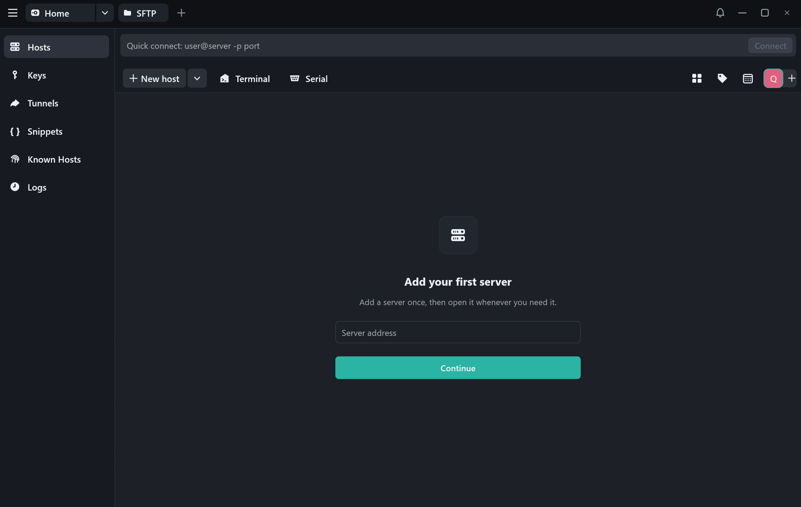
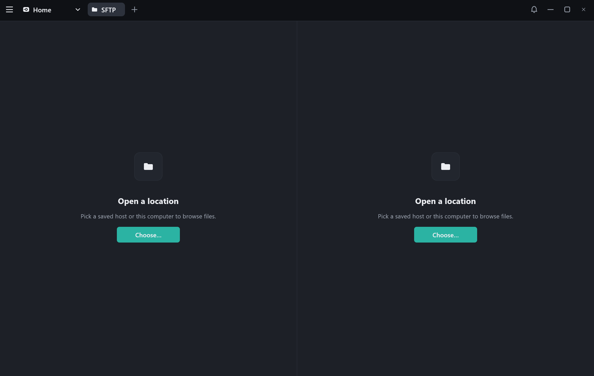
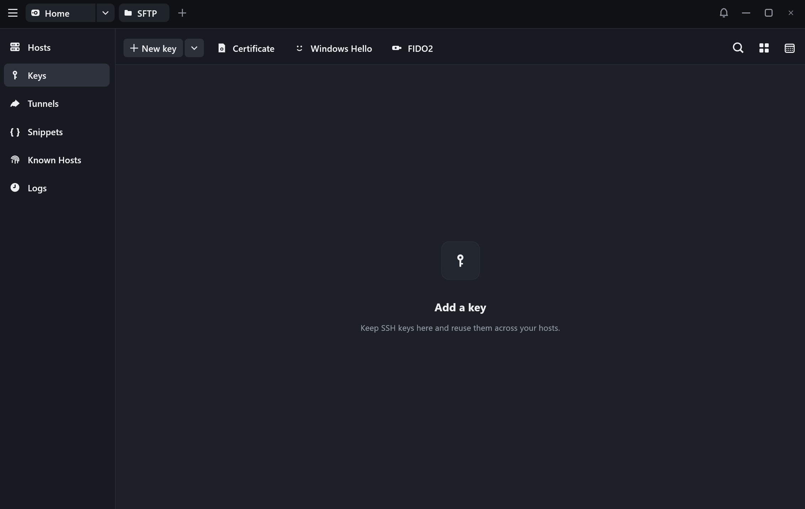

# FreeTerm

**A free, fast and native SSH client for Windows, written in Rust.**

FreeTerm keeps your servers, keys, tunnels and favourite commands in one place, and opens
SSH, SFTP, serial and local terminals in tabs. It's a small native app (no Electron or web
view), it stores everything on your own computer, and it never phones home.

Created by **Daniele Colucci** using AI.



## Features

- **Hosts**: save servers with an address, port, user, password or key, tags and groups.
  Connect in one click, or type `user@server -p port` in the quick-connect bar.
- **Terminals in tabs**: SSH, local shell (PowerShell) and serial ports (COM), with
  256 colours and true colour, 40,000 lines of scrollback and automatic reconnect.
- **SFTP**: two side-by-side panes (remote or local) for browsing, uploading, downloading,
  renaming and deleting files.
- **Keys**: import or generate ED25519, RSA, ECDSA and FIDO2 keys (including Windows Hello).
- **Tunnels**: local, remote and dynamic (SOCKS5) port forwarding.
- **Snippets**: save commands and send them to any terminal; reuse your shell history.
- **Known hosts**: see and remove the server fingerprints you have trusted.
- **Logs**: a list of the sessions you opened.

| SFTP | Keys |
|---|---|
|  |  |

## Requirements

- Windows 10 (1809 or later) or Windows 11, 64-bit.
- The **OpenSSH Client** that ships with Windows (`ssh.exe`, `ssh-keygen.exe`). It is
  installed by default on recent versions. If not: *Settings → System → Optional features →
  Add a feature → OpenSSH Client*.

## Install

Download `freeterm.exe` from the [Releases](../../releases) page and run it. There is
nothing to install.

> Windows SmartScreen may warn about an unknown publisher because the executable is not
> code-signed. Choose *More info → Run anyway*, or build it yourself from source.

## Build from source

You need the latest stable [Rust](https://rustup.rs) toolchain.

```bash
git clone https://github.com/<your-username>/freeterm.git
cd freeterm
cargo build --release
```

The program is written to `target/release/freeterm.exe`.

Run the checks:

```bash
cargo test
cargo clippy --all-targets -- -D warnings
```

## Where your data lives

Everything is stored in `%APPDATA%\FreeTerm\`:

| File | Content |
|---|---|
| `workspace.dat` | Hosts, keys, tunnels, snippets, logs and settings, **encrypted** with Windows DPAPI for your user account |
| `known_hosts` | Fingerprints of servers you trusted |

To start fresh, close FreeTerm and delete that folder. See [SECURITY.md](SECURITY.md) for
details on how passwords and keys are protected.

## How it works

| Part | Built with |
|---|---|
| Window and UI | [egui / eframe](https://github.com/emilk/egui) |
| SSH terminals and tunnels | Windows' OpenSSH client (`ssh.exe`) in a pseudo-console ([portable-pty](https://crates.io/crates/portable-pty)) |
| SFTP | [russh](https://crates.io/crates/russh) and [russh-sftp](https://crates.io/crates/russh-sftp) (pure Rust) |
| Terminal emulation | [vt100](https://crates.io/crates/vt100) |
| Serial ports | [serialport](https://crates.io/crates/serialport) |

Source layout:

```
src/
  main.rs      window setup
  app.rs       screens, tabs and actions
  look.rs      colours, fonts, icons and widgets
  model.rs     saved data (hosts, keys, tunnels…) and helpers
  secure.rs    encryption of the saved data (DPAPI)
  terminal.rs  terminal sessions and drawing
  sftp.rs      SFTP worker and local file operations
```

## Contributing

Bug reports, ideas and pull requests are welcome. Please run `cargo test` and
`cargo clippy --all-targets -- -D warnings` before opening a pull request. Report security
problems privately (see [SECURITY.md](SECURITY.md)).

## License

[MIT](LICENSE) © 2026 Daniele Colucci

FreeTerm is an independent project. It is not affiliated with, endorsed by or derived from
any commercial SSH client.
